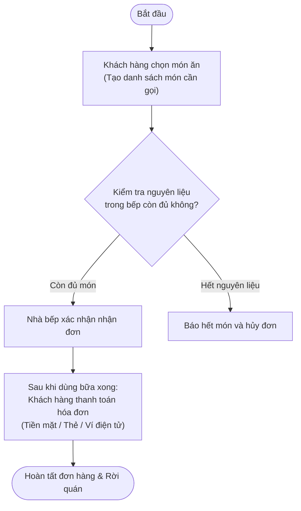

# Mock Project - Restaurant Order & Payment Process (Kiến trúc 3-Layer)

Dự án mẫu (Mock Project) được thiết kế theo **Kiến trúc 3 Tầng (3-Layer Architecture)** bằng **ASP.NET Core (.NET 9)**, triển khai chuẩn hóa theo sơ đồ nghiệp vụ từ Draw.io (`restaurant-order-flow.xml` - **Quy Trình Gọi Món Và Thanh Toán**).

---

## 1. Kiến trúc 3 Tầng (3-Layer Architecture)

```
mock-project/
├── MockProject.sln
├── template_business.json                  # Cấu hình ánh xạ nghiệp vụ cho PACE Analysis
├── MockProject.API/                        # [Tầng 1: Presentation Layer]
│   ├── Controllers/
│   │   └── OrderController.cs              # REST API Controllers
│   ├── Properties/
│   │   └── launchSettings.json
│   ├── Program.cs                          # Cấu hình DI, Middleware, Swagger UI
│   └── MockProject.API.csproj
│
├── MockProject.Business/                   # [Tầng 2: Business Logic Layer (BLL)]
│   ├── DTOs/
│   │   ├── OrderItemDto.cs
│   │   ├── PaymentModels.cs
│   │   └── ProcessOrderDtos.cs
│   ├── Interfaces/
│   │   ├── IOrderService.cs
│   │   ├── IKitchenService.cs
│   │   └── IPaymentService.cs
│   ├── Services/
│   │   ├── OrderService.cs                 # Điều phối toàn bộ luồng nghiệp vụ
│   │   ├── KitchenService.cs               # Xử lý logic kiểm tra và xác nhận bếp
│   │   └── PaymentService.cs               # Xử lý thanh toán hóa đơn
│   └── MockProject.Business.csproj
│
└── MockProject.Data/                       # [Tầng 3: Data Access Layer (DAL)]
    ├── Entities/
    │   ├── Order.cs
    │   ├── OrderItem.cs
    │   ├── OrderStatus.cs
    │   ├── PaymentRecord.cs
    │   └── IngredientStock.cs
    ├── Interfaces/
    │   ├── IOrderRepository.cs
    │   ├── IKitchenRepository.cs
    │   └── IPaymentRepository.cs
    ├── Repositories/
    │   ├── OrderRepository.cs              # Lưu trữ & cập nhật trạng thái đơn
    │   ├── KitchenRepository.cs            # Quản lý kho nguyên liệu & xác nhận bếp
    │   └── PaymentRepository.cs            # Ghi nhận giao dịch thanh toán
    └── MockProject.Data.csproj
```

---

## 2. Sơ đồ luồng nghiệp vụ (Business Flow)

Dự án hiện thực hóa chính xác quy trình nghiệp vụ trong `restaurant-order-flow.xml`:



---

## 3. Đặc tả API đại diện cho luồng (`POST /api/order/process`)

API chính mô tả toàn bộ luồng nghiệp vụ trên:

* **Endpoint:** `POST /api/order/process`
* **Mô tả:** Nhận danh sách món ăn từ khách hàng, kiểm tra nguyên liệu tồn kho tại bếp, nếu đủ thì bếp xác nhận và tiến hành thanh toán, cập nhật trạng thái đơn hàng thành hoàn tất; nếu thiếu nguyên liệu thì báo hết món và hủy đơn.

### Call Stack truy vết luồng (Targeted Entry Points):
1. **API / Controller:** `OrderController.ProcessOrderAsync`
2. **Service Layer:**
   - `IOrderService.ProcessOrderAsync` -> `OrderService.ProcessOrderAsync`
   - `IKitchenService.CheckIngredientsAvailabilityAsync` -> `KitchenService.CheckIngredientsAvailabilityAsync`
   - `IKitchenService.ConfirmOrderAsync` -> `KitchenService.ConfirmOrderAsync`
   - `IPaymentService.ProcessPaymentAsync` -> `PaymentService.ProcessPaymentAsync`
3. **Repository Layer:**
   - `IOrderRepository.CreateOrderAsync` -> `OrderRepository.CreateOrderAsync`
   - `IKitchenRepository.CheckStockAsync` -> `KitchenRepository.CheckStockAsync`
   - `IKitchenRepository.ConfirmOrderInKitchenAsync` -> `KitchenRepository.ConfirmOrderInKitchenAsync`
   - `IPaymentRepository.SavePaymentAsync` -> `PaymentRepository.SavePaymentAsync`
   - `IOrderRepository.UpdateOrderStatusAsync` -> `OrderRepository.UpdateOrderStatusAsync`

---

## 4. Hướng dẫn chạy và kiểm thử

### Khởi động dự án:
```bash
dotnet run --project MockProject.API/MockProject.API.csproj
```
Truy cập Swagger UI tại: `http://localhost:5042/swagger` hoặc `https://localhost:7055/swagger`.

### Kịch bản 1: Happy Path (Còn đủ món trong bếp)
* Món ăn chọn: `Phở Bò` (kho còn 10), `Trà Đào Cam Sả` (kho còn 20).
* **Payload:**
```json
{
  "customerName": "Nguyen Van A",
  "tableNumber": "Ban 05",
  "paymentMethod": "Vi dien tu",
  "items": [
    { "itemName": "Phở Bò", "quantity": 2, "unitPrice": 50000 },
    { "itemName": "Trà Đào Cam Sả", "quantity": 2, "unitPrice": 30000 }
  ]
}
```
* **Kết quả trả về (200 OK):**
```json
{
  "orderId": "edc70bd2-e6b7-42c8-9915-cb94c4f17317",
  "isSuccess": true,
  "status": "Completed",
  "totalAmount": 160000,
  "paymentMethod": "Vi dien tu",
  "message": "Đơn hàng hoàn tất thành công. Mã giao dịch: TXN-34796F80.",
  "flowStepsExecuted": [
    "Bước 1: Khách hàng chọn món ăn & Tạo danh sách món cần gọi",
    "Bước 2: Kiểm tra nguyên liệu trong bếp còn đủ không?",
    "Nhánh rẽ: Còn đủ món -> Nhà bếp xác nhận nhận đơn",
    "Bước 3: Khách hàng thanh toán hóa đơn bằng phương thức 'Vi dien tu'",
    "Bước 4: Hoàn tất đơn hàng & Khách hàng rời quán"
  ]
}
```

### Kịch bản 2: Exception Path (Hết nguyên liệu trong bếp)
* Món ăn chọn: `Tôm Hùm Alaska` (kho tồn = 0).
* **Payload:**
```json
{
  "customerName": "Tran Thi B",
  "tableNumber": "Ban 02",
  "paymentMethod": "Tien mat",
  "items": [
    { "itemName": "Tôm Hùm Alaska", "quantity": 1, "unitPrice": 500000 }
  ]
}
```
* **Kết quả trả về (400 Bad Request):**
```json
{
  "orderId": "0e6b0bc4-5560-4c68-86d6-f275156227be",
  "isSuccess": false,
  "status": "Cancelled",
  "totalAmount": 500000,
  "paymentMethod": "Tien mat",
  "message": "Bếp báo không còn đủ nguyên liệu cho món ăn yêu cầu. Đơn hàng đã bị hủy theo quy trình.",
  "flowStepsExecuted": [
    "Bước 1: Khách hàng chọn món ăn & Tạo danh sách món cần gọi",
    "Bước 2: Kiểm tra nguyên liệu trong bếp còn đủ không?",
    "Nhánh rẽ: Hết nguyên liệu -> Báo hết món và hủy đơn"
  ]
}
```

